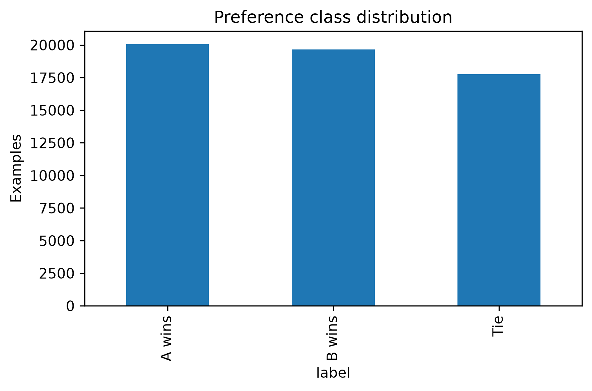
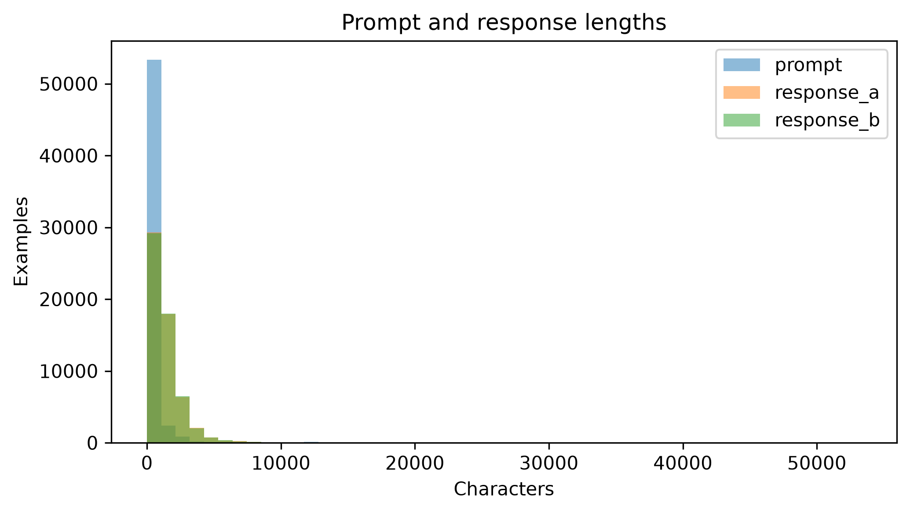

# First-draft report — NLP-3

## Problem and scope

Predict a human judge's preference between responses A and B to the same prompt, with a third label for a tie. Return probabilities in the order `0 = A wins`, `1 = B wins`, `2 = tie`. This is multiclass classification with no single positive class. This draft records completed data exploration and a class-prior validation baseline; text-based models remain planned.

## Current evidence

The local exploration notebook has been executed successfully, with no saved error outputs. Dataset counts, parsed-text lengths, saved partitions, and baseline metrics were verified on October 21, 2026. The recomputed baseline matches the saved validation scores exactly. These are real-dataset findings, separate from the starter's synthetic software checks.

The dataset and fixed split files remain local and Git-ignored. The executed [notebook](../notebooks/01_data_exploration.ipynb), figures, [baseline metrics](../results/metrics/class_prior_validation.json), [package versions](../results/metrics/versions.json), and [report audit evidence](../results/metrics/lab04_report_evidence.json) accompany this report.

## Data audit — completed

| Item | Verified result |
|---|---|
| Raw training CSV | 57,477 rows × 9 original columns |
| After parsing and derived fields | 57,477 rows × 14 columns |
| A wins / B wins / tie counts | 20,064 / 19,652 / 17,761 |
| A wins / B wins / tie percentages | 34.91% / 34.19% / 30.90% |
| Missing cells in the raw CSV | 0 across all original columns |
| JSON parsing and schema validation | All rows passed the current loader |
| Empty joined prompt / response A / response B text | 0 / 30 / 33 |
| Repeated parsed-prompt rows after the first occurrence | 5,743 |
| Duplicate joined prompt/response-A/response-B triplets after the first occurrence | 71 |
| Prompt groups appearing across partitions | 0 |
| Unordered joined response-pair groups appearing across partitions | 27 groups, involving 196 rows |
| Underlying user/session/source-document separation | Unverified; these identifiers are not provided in the CSV |

“Duplicate triplets” compares text inputs, not complete CSV rows or labels. JSON null turns are permitted and become empty strings, so zero missing CSV cells does not mean every parsed response contains text. Empty responses need inspection before choosing a filtering policy.

### Prompt and response lengths

Lengths below count characters in joined parsed text, not tokens.

| Statistic | Prompt | Response A | Response B |
|---|---:|---:|---:|
| Count | 57,477 | 57,477 | 57,477 |
| Mean | 352.36 | 1,330.37 | 1,337.18 |
| Standard deviation | 1,025.38 | 1,461.91 | 1,483.79 |
| Minimum | 3 | 0 | 0 |
| 25th percentile | 48 | 391 | 395 |
| Median | 91 | 1,036 | 1,044 |
| 75th percentile | 233 | 1,810 | 1,819 |
| Maximum | 32,833 | 53,299 | 52,402 |

The means exceed the medians and maximum lengths are large, indicating long right tails. Later models need an explicit tokenization and truncation policy; character counts alone do not establish token limits.

### Leakage findings and remaining review

Prompt grouping prevents the same parsed prompt from crossing partitions. However, the additional response-pair audit found 27 unordered response-pair groups crossing partitions, involving 196 rows. It compares joined response text and treats A/B-swapped pairs as equivalent. Some repeated pairs may be generic or empty replies; this is evidence of overlap, not proof that every repeated pair inflates scores.

The prior baseline uses no text features, but future text models may exploit this overlap. Inspect the pairs and agree on whether to remove duplicates or group connected prompts and response pairs into a newly versioned split. Preserve the current assignments and rerun all comparable models if the split policy changes. Do not describe the current split as fully free of leakage. User/session/source-document separation remains unverified.

## Evaluation design

The saved split uses seed 42 and nested `StratifiedGroupKFold` grouped by parsed prompt. All three classes occur in every partition; no prompt group crosses partitions.

| Partition | A wins | B wins | Tie | Total |
|---|---:|---:|---:|---:|
| Train | 12,039 | 11,791 | 10,657 | 34,487 |
| Validation | 4,013 | 3,931 | 3,552 | 11,496 |
| Local test | 4,012 | 3,930 | 3,552 | 11,494 |

Reuse the exact assignments in `data/splits/split_ids.csv`, checked against `data/splits/manifest.json`, for model comparisons. Teammates must share these files privately; the random seed alone is not the split artifact. The dataset SHA-256 is `0692154aaf20fc6649090c3f49b6b5dd1e693a765ecb5f0856ae0da5946f5be2`.

Model names and IDs are not predictive features. Fit vocabulary, transformations, priors, and classifiers on training data only. Validation supports model selection. Later calibration needs a designated validation subset or nested procedure. The local test partition has not been scored; the table above reports composition only.

## Experiment table

| Method | Validation log loss | Accuracy | Macro F1 | Status |
|---|---:|---:|---:|---|
| Class-prior probabilities | 1.097224 | 34.9078% | 0.172502 | Completed; recomputed and matched saved output |
| Numerical features + classifier | — | — | — | Planned |
| TF-IDF + logistic regression | — | — | — | Planned |
| Frozen embeddings + classifier | — | — | — | Planned |
| DeBERTa | — | — | — | Planned |

The baseline predicts training class probabilities `[0.349088, 0.341897, 0.309015]` for every validation example. Its hard prediction is always A wins. Lower log loss is better; a uniform three-class predictor has log loss `ln(3) ≈ 1.098612`. The measured prior baseline improves this only slightly. Its 34.91% accuracy does not show learned preference understanding, and its low macro F1 exposes its failure to predict B wins or tie.

## Completed deliverables and planned analysis

Completed artifacts include the exploration notebook, class-distribution and text-length charts, fixed local split assignments, validation baseline metrics, package versions, and the [six-question Lab 04 report](lab04_project_report.md). Figures are stored in `results/figures/`, metrics in `results/metrics/`, and reports in `reports/`.

Future work will examine A/B position bias, response-length effects, calibration, and high-confidence errors. Compare models on identical agreed partitions and report variation across training seeds. Make a final local test evaluation only after model choices are fixed. The baseline and data audit are completed; text-model experiments and GPU suitability remain unverified.

## Next work

1. Inspect empty responses and the 27 cross-partition response-pair groups; agree on and document the split/filtering policy.
2. Lock and privately share the agreed split version. If it changes, recompute the baseline and rerun every comparison.
3. Implement numerical-feature and TF-IDF logistic-regression baselines using training-only feature fitting.
4. Add per-class analysis and calibration evaluation before moving to embeddings or fine-tuning.

Reproduce the existing baseline with `python -m src.baseline`. Reproduce the supplementary overlap audit with `python scripts/lab04_report_evidence.py`, using the same local dataset and saved split files.
